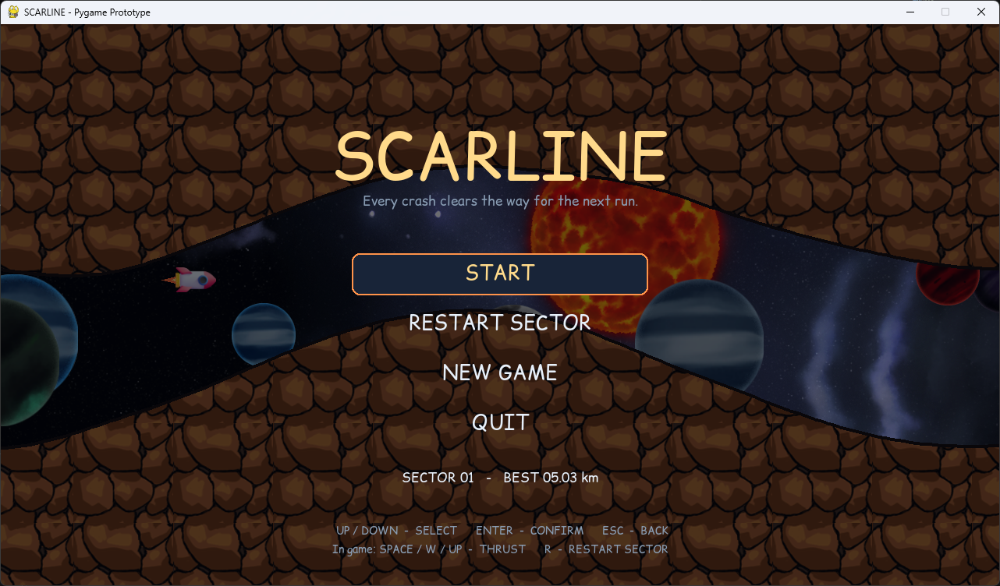

# SCARLINE — Pygame prototípus

Egy 2D-s, oldalnézetes rakétás játék első játszható alapja. A rakéta folyamatosan előre halad, a játékos a hajtóművel felfelé tud gyorsítani, a gravitáció pedig lefelé húzza. Hiba után a pálya elölről indul, a kráterek eltűnnek, de a korábbi próbálkozások szellemként együtt indulnak az új rakétával, és a hibapontjukon felrobbantják a pályát, így ott át lehet menni.



## Követelmény

- Python 3.10 vagy újabb ajánlott
- Pygame 2.x

## Indítás Windows alatt

Nyiss terminált ebben a mappában, majd:

```powershell
py -m venv .venv
.venv\Scripts\activate
python -m pip install -r requirements.txt
python main.py
```

Ha a `py` parancs nincs telepítve, használd a `python` parancsot.

## Windows release

A kész, Python nélkül futtatható csomag a GitHub Releases oldalról tölthető le (`Scarline-win64.zip`): kicsomagolás után `Scarline.exe`. Saját build:

```powershell
.venv\Scripts\python.exe -m pip install pyinstaller
.venv\Scripts\python.exe -m PyInstaller --noconfirm --onedir --windowed --name Scarline --add-data "Assets\Background;Assets\Background" --add-data "Assets\Fonts;Assets\Fonts" --add-data "Assets\Ground_Stone;Assets\Ground_Stone" --add-data "Assets\Other;Assets\Other" main.py
```

A mentés (`save.json`) az exe mellé kerül.

## Irányítás

- `Space`, `W` vagy `Fel` — hajtómű, felfelé gyorsulás
- Menü: `Fel/Le` vagy `W/S` választás, `Enter`/`Space` megerősítés
- `R` — az aktuális szint teljes újrakezdése, a szellemek és a rekord törlése
- `Esc` — menü (a menüben: vissza)
- A szint végén `Enter`, `Space` vagy `N` — következő szint

## Mi van már benne?

- Fix seed alapján determinisztikusan generált plafon és padló.
- Függőleges rakétamozgás gravitációval és hajtóművel.
- Gyorsabb, nehezebb játék: hosszú, meredek emelkedők és lejtők, szűk járat.
- Hiba után újraindulás a pálya elejéről; a korábbi próbák szellemként futnak, és a hibapontjukon krátert robbantanak.
- Hirtelen, szinte zárt kapuk a pályán: kráter nélkül lehetetlen átjutni, a szellemek robbantása nyitja meg őket.
- Minden újabb szellem korábbról (előrébb) indul, így a robbanások előbb történnek, mint hogy a játékos odaér.
- Fix 120 Hz-es fizikai lépés, hogy a szellemek pontosan szinkronban maradjanak.
- Grafika az Assets mappából ([assets.py](assets.py)): parallax űrháttér, animált nap és bolygók, egyetlen csempéből ismétlődő kő/föld terep, rakéta-sprite (a szellemek kék, áttetsző változata), PNG-s robbanás és porfelhők.
- Főmenü (Start/Resume, Restart sector, New game, Quit) és szünet az Esc-re; egyedi betűtípus az Assets/Fonts mappából.
- Gravitációváltás: a 2. szinttől egy, a 4. szinttől két zóna, ahol a világ fejjel lefelé fordul és a gravitáció felfelé hat (a hajtómű is megfordul). A pályán lila (belépés) és kék (visszaállás) sáv, felirat, a HUD-on gravitációjelző, villogó figyelmeztetés és jelölők a haladási csíkon.
- Oldalirányú forgatás: a 6. szinttől egy, a 8.-tól két zóna, ahol az egész nézet 90 fokkal elfordul (előre = felfelé, a gravitáció jobbra húz, a hajtómű balra tol). Narancs (belépés) és zöld (kilépés) sáv jelzi. A 10. szinten minden kombinálva van: a fordított gravitációs zóna egy forgatott zóna közepén kezdődik.
- Szektorválasztó a menüben (1–10): `Bal/Jobb` vagy `A/D`; szektoronként külön rekord, a mentés 3-as verziójú.
- Képernyőrázkódás és HUD.
- JSON mentés: a szint és a rekord (a szellemek nem maradnak meg újraindítás után).
- A következő szint új, determinisztikus, szűkebb és gyorsabb pályát generál.

## Fontos prototípus-korlát

Ez az első játszható változat, ezért a kráterek mintavételezett görbékbe vágódnak, nem tetszőleges poligonból távolítanak el pixeleket. Ez ennél a két felületből álló pályatípusnál egyszerűbb és jól tesztelhető megoldás.


