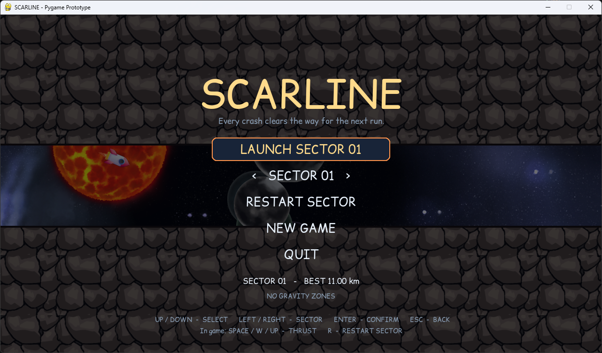

# SCARLINE

*[Magyar verzió: README.hu.md](README.hu.md)*

A fast, hard 2D side-view rocket game built with Pygame. The rocket flies forward on its own; you only control the engine. Every crash restarts the sector from the beginning and the craters vanish, but all your previous attempts launch together with you as **ghosts** and blast open the terrain at the point where they crashed, so you can get through there.



## Download (Windows)

Grab `Scarline-win64.zip` from the [Releases](https://github.com/dedsecds22/Scarline/releases) page, extract it and run `Scarline.exe`. No Python needed. The save file (`save.json`) is written next to the exe.

## Run from source

Requires Python 3.10+ and Pygame 2.x.

```powershell
py -m venv .venv
.venv\Scripts\activate
python -m pip install -r requirements.txt
python main.py
```

## Build the Windows release

```powershell
.venv\Scripts\python.exe -m pip install pyinstaller
.venv\Scripts\python.exe -m PyInstaller --noconfirm --onedir --windowed --name Scarline --add-data "Assets\Background;Assets\Background" --add-data "Assets\Fonts;Assets\Fonts" --add-data "Assets\Ground_Stone;Assets\Ground_Stone" --add-data "Assets\Other;Assets\Other" main.py
```

## Controls

| Key | Action |
|---|---|
| `Space` / `W` / `Up` | Engine thrust |
| `Esc` | Menu (in the menu: back) |
| `R` | Restart the sector completely (ghosts and best distance are wiped) |
| `Up` / `Down` (`W` / `S`) | Menu selection |
| `Left` / `Right` (`A` / `D`) | Change sector in the menu |
| `Enter` / `Space` | Confirm; at the end of a sector, go to the next one |

## Gameplay

- Deterministic, seed-based terrain with long, steep ramps and a narrow passage; each sector is narrower and faster than the last.
- **Ghosts:** after every crash the previous runs replay and blast a crater where they failed. Each newer ghost starts slightly earlier, so the explosions arrive ahead of you instead of all at once.
- **Gates:** sudden, almost fully closed sections that are impossible to pass until a ghost blasts them open.
- **Gravity flip** (sector 2+: one zone, sector 4+: two): the whole view turns upside down, gravity pulls up and the engine pushes down. Marked by purple (enter) and cyan (exit) bands.
- **Gravity turn** (sector 6+: one zone, sector 8+: two): the whole view rotates by 90°; you travel upward, gravity pulls right and the engine pushes left. Marked by orange (enter) and green (exit) bands.
- **Sector 10** combines everything, including a flip zone that begins in the middle of a turn zone.
- Sector selector (1–10) in the main menu, with a separate best distance per sector.
- HUD with distance, speed, gravity indicator, "ahead" warnings and zone markers on the progress bar.

## Technical notes

- Fixed 120 Hz physics step, so ghost recordings always replay in sync.
- Graphics are loaded from the `Assets` folder ([assets.py](assets.py)): parallax space backgrounds, an animated sun, planets, repeating ground tile, rocket sprite, PNG explosions and dust, custom font.
- JSON save with the current sector and per-sector bests (ghosts are not saved).
- Craters are cut into sampled floor/ceiling curves rather than arbitrary polygons, which keeps the terrain simple and testable.
